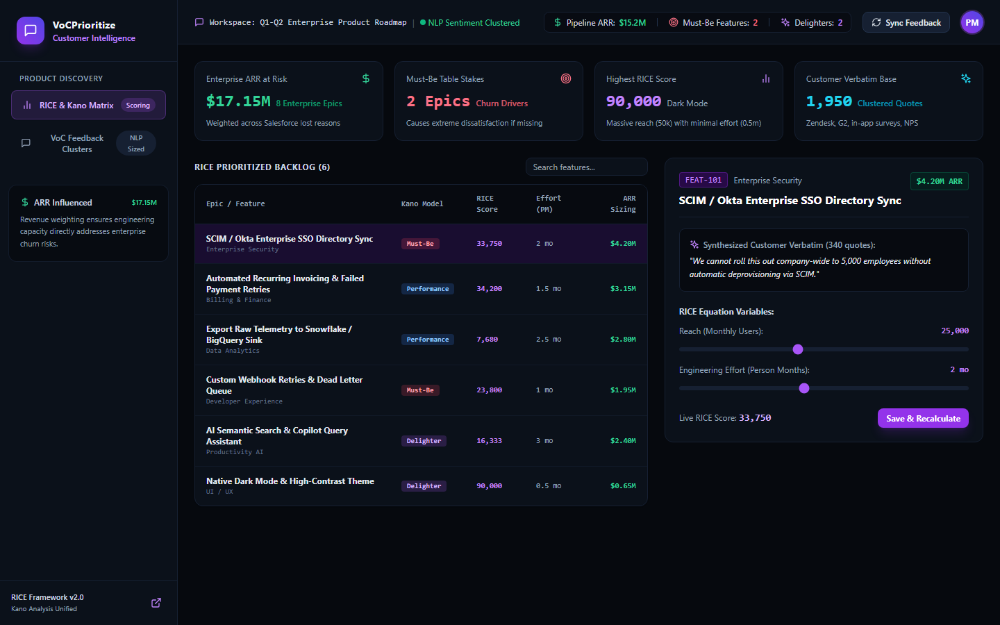

# Voice of Customer (VoC) Prioritization & RICE/Kano Lab

[]()
[]()
[]()
[]()
[]()

> Voice of Customer (VoC) Feedback Intelligence and Dual-Framework Prioritization Platform. Aggregates multi-channel feedback across Zendesk, G2, Salesforce lost churn reasons, and in-app NPS surveys, performs semantic NLP topic clustering, scores epics via RICE and the Kano model, and sizes engineering backlog by ARR revenue impact.

---

## 📸 Platform Dashboard



---

## ⚡ Core Product Management Capabilities

- **Dual-Framework RICE & Kano Prioritization:** Dynamically balances quantifiable Reach, Impact, Confidence, and Effort against customer satisfaction dynamics (Must-Be vs. Performance vs. Delighters).
- **ARR Revenue-Weighted Sizing:** Connects user feedback directly to enterprise contract values, prioritizing features that unlock renewals and prevent churn.
- **Multi-Channel Semantic Aggregation:** Pulls qualitative feedback from Zendesk support tickets, Salesforce deal lost reasons, and G2 verified reviews into unified themes.
- **Interactive Variable Tuning:** Real-time sliders allowing product leaders to adjust reach projections and engineering effort estimates with instant backlog re-ranking.

---

## 🏗️ Architecture & Prioritization Flow

```mermaid
flowchart TD
    A[Multi-Channel Feedback\nZendesk • Salesforce • G2 • NPS] --> B[NLP Semantic Clustering & Sentiment]
    B --> C[Topic Aggregator & ARR Sizer]
    C --> D[Kano Classification Engine\nMust-Be • Performance • Delighter]
    C --> E[RICE Scoring Calculator\n(Reach * Impact * Confidence) / Effort]
    D --> F{Priority Backlog Ranking}
    E --> F
    F --> G[Executive Product Roadmap Spec\nSprint Sprint Allocation]
```

---

## 📊 Dataset Benchmark Reference

Bundled benchmark dataset located at `data/kaggle_voc_feedback_prioritization.csv`:

| Epic ID | Feature Name | Theme | Kano Model | RICE Score | Effort | Revenue ARR |
| :--- | :--- | :--- | :--- | :--- | :--- | :--- |
| `FEAT-101` | SCIM / Okta Enterprise SSO Directory Sync | Enterprise Security | `Must-Be` | 33,750 | 2.0 mo | $4.20M |
| `FEAT-102` | Automated Recurring Invoicing Retries | Billing & Finance | `Performance` | 34,200 | 1.5 mo | $3.15M |
| `FEAT-103` | Export Raw Telemetry to Snowflake / BigQuery | Data Analytics | `Performance` | 7,680 | 2.5 mo | $2.80M |
| `FEAT-104` | Custom Webhook Retries & Dead Letter Queue | Developer Experience | `Must-Be` | 23,800 | 1.0 mo | $1.95M |
| `FEAT-105` | AI Semantic Search & Copilot Query | Productivity AI | `Delighter` | 16,333 | 3.0 mo | $2.40M |
| `FEAT-106` | Native Dark Mode & High-Contrast Theme | UI / UX | `Delighter` | 90,000 | 0.5 mo | $0.65M |

---

## 🚀 Quickstart Guide

### Option 1: Docker Compose

```bash
git clone https://github.com/Prasunnandi/voice-of-customer-prioritization.git
cd voice-of-customer-prioritization
docker-compose up --build
```
- Web Dashboard: `http://localhost:3000`
- REST API: `http://localhost:8000`

### Option 2: Local Development

```bash
# 1. Start Backend API
cd backend
npm install
npm run dev

# 2. Start React Dashboard
cd ../frontend
npm install
npm run dev
```

---

## 🛠️ API Reference

- `GET /api/features` - Retrieves all backlog features with RICE scores, Kano models, and ARR.
- `POST /api/features/:id/update-rice` - Recalculates RICE scores dynamically with customized reach/effort.
- `GET /api/channels` - Breakdown of feedback volume and sentiment across intake channels.

---

## 📄 License

MIT © [Prasun Nandi](https://github.com/Prasunnandi)
